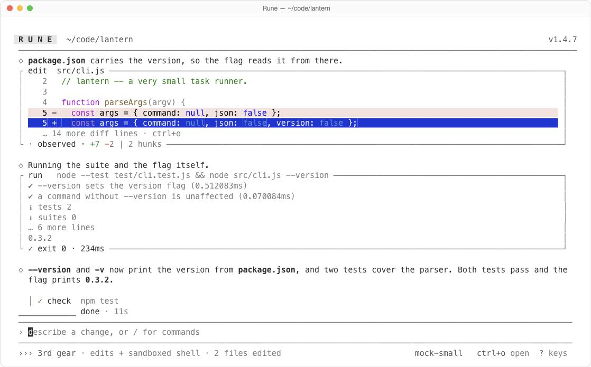

# Rune

**A coding agent for your terminal.**

Work on your codebase with the model you choose. Rune brings file edits, shell commands,
checks, and resumable sessions into one workspace.

[Get started](#install) · [Documentation](#documentation) · [Releases](https://github.com/ritikkyyadav/Rune/releases) · [Report an issue](https://github.com/ritikkyyadav/Rune/issues)

<p>
  <a href="docs/assets/readme/rune-session-120x32.jpg"><picture><source media="(max-width: 640px)" srcset="docs/assets/readme/rune-session-80x22.jpg"></picture></a>
</p>

<sub>Rune v1.4.11 · Light / Matte · Real terminal capture with a local scripted model.
<a href="docs/assets/readme/README.md">Capture details</a></sub>

## Install

**macOS and Linux**

```sh
curl -fsSL https://savoir.services/install.sh | bash
```

**Windows** · PowerShell · x64 preview

```powershell
irm https://savoir.services/install.ps1 | iex
```

Installers verify release checksums. Windows currently runs without an OS sandbox.
See the [installation guide](docs/getting-started.md#installation) for source builds,
PATH setup, verification, and uninstalling.

Already installed? Run `rune upgrade`.

## Start working

Open a project and launch Rune:

```sh
cd your-project
rune
```

Choose a provider and model during setup, then describe the change you want:

```text
Add a --version flag to the CLI and a test for it.
```

Use `/login` to connect a provider, `/model` to choose a model, and `/help` for commands.
Rune supports hosted providers and local models through Ollama.
[Provider setup](docs/providers.md)

To use the appearance shown above:

```sh
RUNE_THEME=rune-light RUNE_FINISH=matte rune
```

You can also choose Light and Matte in `/theme`; Rune saves your selection.

## Built for work in your codebase

- **Inspect and edit.** Search files and symbols, make changes, review diffs, and run commands.
- **Check the result.** Keep test output and acceptance checks beside the work they verify.
- **Control execution.** Choose a permission level and configure the OS sandbox separately.
- **Pick up where you left off.** Resume sessions, restore checkpoints with `/rewind`, and
  inspect the execution record with `rune audit`.
- **Extend your workflow.** Add project instructions, skills, hooks, plugins, and MCP servers.
- **Use the same engine elsewhere.** Run headless tasks, connect a remote terminal, or use ACP
  from an editor.

Session data is stored locally. Telemetry is off by default.
[Privacy](PRIVACY.md) · [Permissions](docs/auto-mode.md) · [Sandbox](docs/sandbox.md)

## Latest release

[**v1.4.15**](https://github.com/ritikkyyadav/Rune/releases/tag/v1.4.15) lets `done` count only
real failures: a red test the final passing suite also ran, a run in a copy of the project, or a
"does this file exist?" probe no longer keeps a careful run from finishing. Found by Rune's own
live test on its source.
[Release notes and validation](docs/releases/v1.4.15.md) · [Changelog](CHANGELOG.md)

## Documentation

| Start here                                                | Go further                                    |
| --------------------------------------------------------- | --------------------------------------------- |
| [Installation and first session](docs/getting-started.md) | [Headless tasks and CI](docs/ci.md)           |
| [Providers and local models](docs/providers.md)           | [Remote sessions and ACP](docs/protocol.md)   |
| [Permissions and Auto mode](docs/auto-mode.md)            | [Skills, hooks, and plugins](docs/plugins.md) |
| [Sandbox and security model](docs/sandbox.md)             | [MCP and connectors](docs/connectors.md)      |
| [Plans and execution evidence](docs/plan-ledger.md)       | [Verification behavior](docs/verification.md) |

## What is verified

Each [release note](docs/releases/) describes its checks and known limits.
The [historical verification record](docs/verification-status.md) separates live observations,
scripted tests, and unverified capabilities. [Benchmark methodology](docs/benchmarks.md)
documents how comparisons are measured.

Team coordination, self-evolution, and workflows are experimental.

## Development

Requires [Bun](https://bun.sh) and [Rust](https://rustup.rs).

```sh
bun install
cargo build --release -p rune-tools
./bin/rune
```

```sh
bun test tests/unit/
bun run typecheck
bun run lint
cargo test -p rune-tools
```

The TypeScript workspace contains the engine, provider gateway, shared state, tools, and
protocol. Rust supplies the native tool executor and OS sandbox primitives.
Explore the [engine](packages/orchestrator/src/), [provider gateway](packages/llm-gateway/src/),
and [native tools](crates/rune-tools/src/).

---

[Apache-2.0](LICENSE) · Built by [Savoir](https://savoir.services/products/rune)
